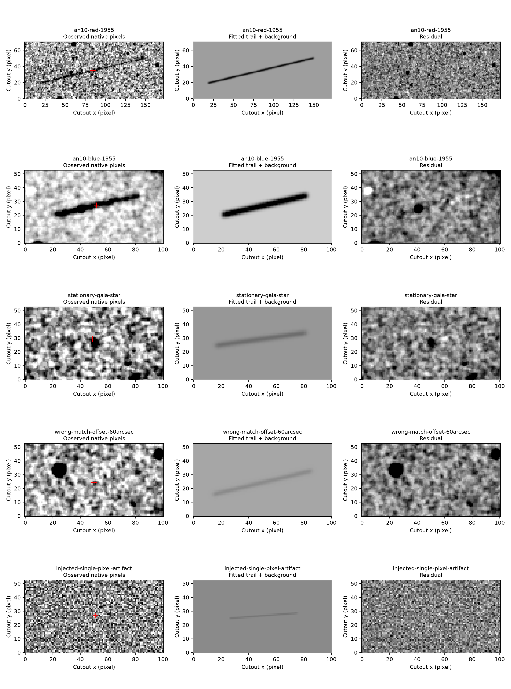

# Asteroid precovery — Discovery@Home research pilot

This pilot reproduces **1999 AN10 on two Palomar plates from January 26, 1955**, using public archival FITS pixels, frozen JPL predictions and a Gaia DR3 calibration subset. Both trails pass the replication screen; four negative controls fail. **No new observation is claimed, accepted, announced or submitted.** Scientific review and a consenting maintainer remain unassigned.

The documented precedent is [MPEC 1999-N21](https://www.minorplanetcenter.net/iau/mpec/J99/J99N21.html), supported by [NASA/JPL's contemporary account](https://cneos.jpl.nasa.gov/news/news018a.html). It reports four trail ends from two exposures. The pilot measures exposure midpoints; it does not count trail ends as independent images.

## Run locally

Python **3.14** was tested on macOS arm64. All astronomical inputs are included, so the reduction is offline. Installation needs PyPI; no global installation is required.

```sh
python3 -m venv .venv
.venv/bin/python -m pip install --only-binary=:all: -r requirements.lock
PYTHONPATH=src .venv/bin/python -m precovery.reproduce
PYTHONPATH=src .venv/bin/python -m unittest discover -s tests -v
```

Expected final line:

```text
PASS: 2 documented exposures reproduced; 4 negative controls rejected; review pending; no submission.
```

A replay takes seconds after dependency installation. The bundled data and source are small; the local environment uses most of the disk space. `make verify` runs the same checks. To compare against checked-in outputs without replacing them:

```sh
PYTHONPATH=src .venv/bin/python -m precovery.reproduce .replay/output
```

## Results to inspect

| Control | Midpoint residual | Result |
|---|---:|---|
| 1955 red plate, XE036 / 07ID | approximately 4.0 arcsec | Replication screen passes |
| 1955 blue plate, XO036 / A3AY | approximately 1.0 arcsec | Replication screen passes |
| Real Gaia stationary source | approximately 406 arcsec | Rejected |
| Candidate search offset by 60 arcsec | approximately 58 arcsec | Rejected |
| Injected single-pixel artifact | approximately 0.13 arcsec | Rejected despite close position |
| Actual 1953 overlapping plate XE035 | Epoch mismatch | Rejected before measurement |



Open [the evidence guide](review/EVIDENCE.md), [measurements](data/derived/measurements.json), [pair motion](data/derived/pair-motion.json), [predictions](data/derived/predictions.json), [calibration](data/derived/calibration.json) and [review record](review/record.json). [Input hashes](data/manifest.json), [versions](data/versions.json), full FITS headers and per-file acquisition provenance are included. [Research brief](research/BRIEF.md) compares MOST, other archives, prediction tools and reporting requirements.

**Timing is the principal unresolved scientific issue.** The archive headers disagree with the original published observation times. The reproduction uses the published trail-end times through an explicit [override](data/controls.json), never by fitting times to the orbit. Times are UT1, not UTC. The current JPL orbit includes these historical observations, so this is a retrospective replication rather than an independent orbit validation. The approximately 43.96-year historical extension is already known; the pilot contributes zero new arc extension. Orbital-uncertainty improvement is unmeasured.

## Research and review

Start with [AGENTS.md](AGENTS.md) and [DISCOVERY.md](DISCOVERY.md). Four weighted tracks cover archive searches, astrometric verification, image-pipeline improvements and expert review. The public repository may be listed by the Discovery@Home hub, but donated sessions remain paused. No scientific maintainer or review capacity is assigned; one must explicitly agree before contributions can be accepted.

Original code: MIT. Original prose: CC BY 4.0. External images, catalogue extracts and literature retain their original rights and credits; see [data credits](DATA_LICENSES.md).

Optional network refreshes are separate from the baseline:

```sh
PYTHONPATH=src .venv/bin/python -m precovery.online --output research/new-snapshot
PYTHONPATH=src .venv/bin/python -m precovery.online --most-only --output research/most-query
```

The first command retrieves new Horizons/SBDB/Gaia snapshots, searches IRSA coverage and downloads bounded native-pixel ranges. The second records a bounded MOST coverage query for this asteroid in 2010; that query is **not a precovery control**. Online service changes or errors do not alter the frozen offline result. New snapshot directories must not already exist.
